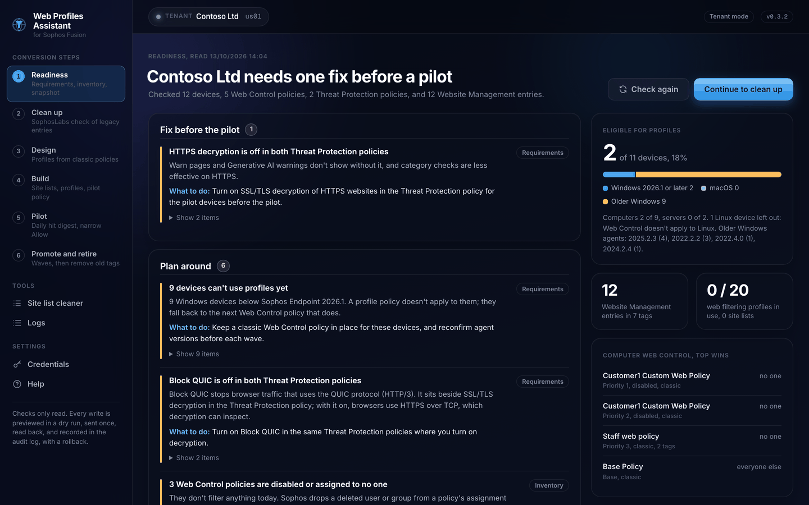
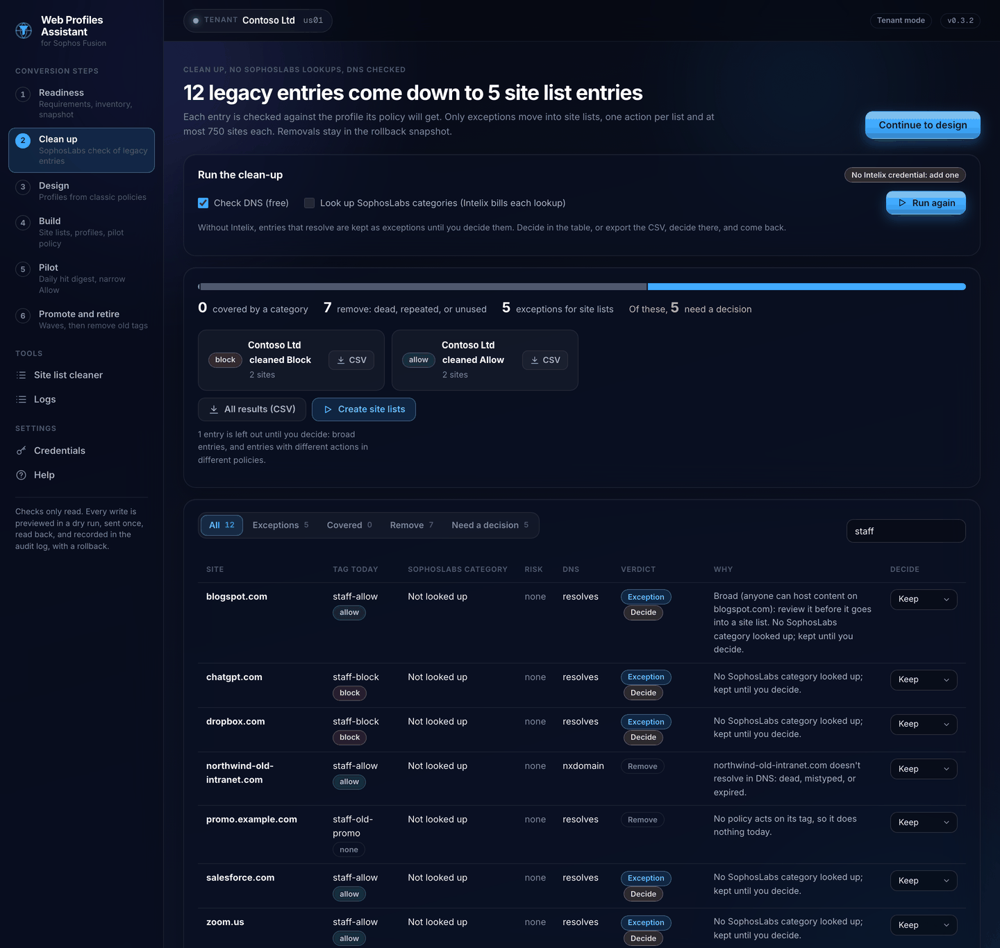
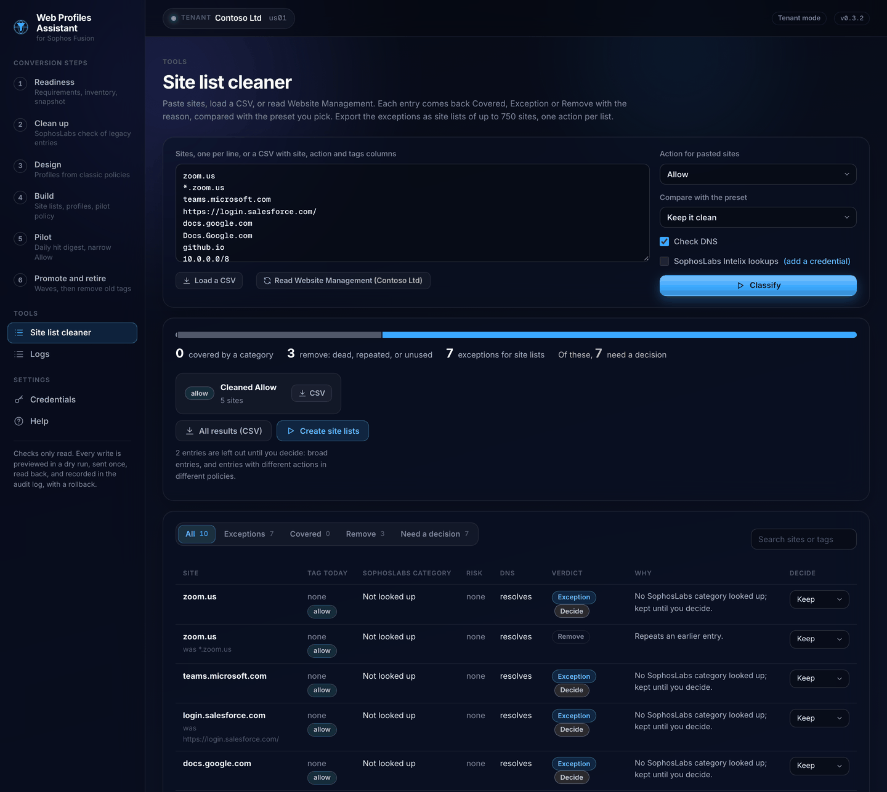
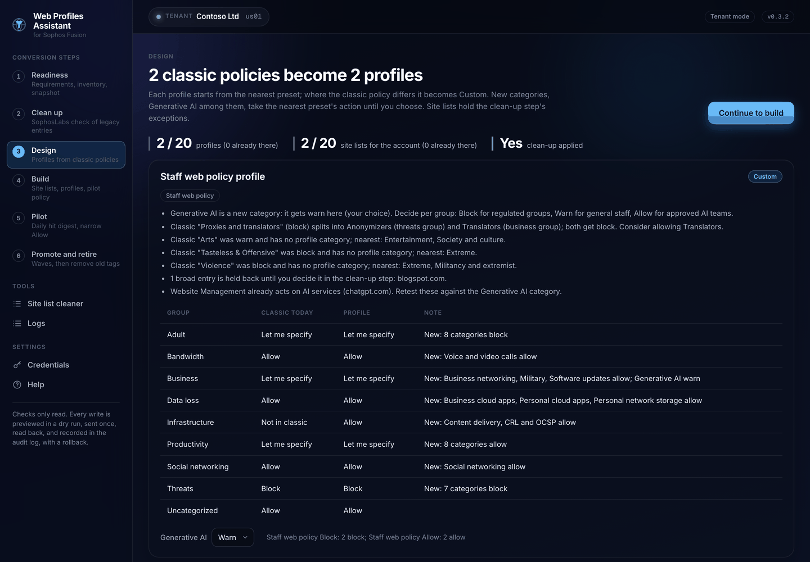
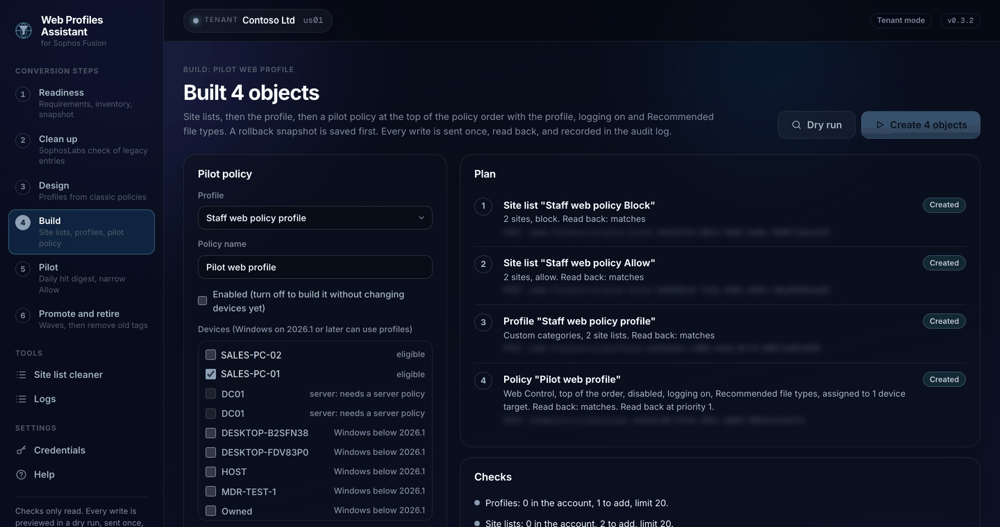
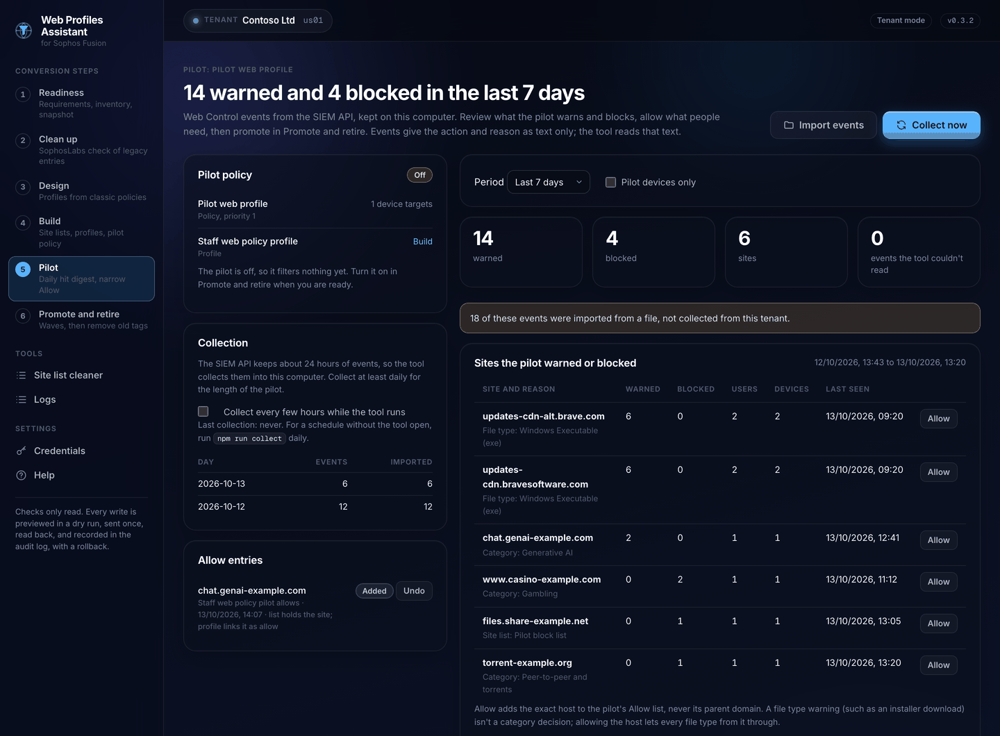
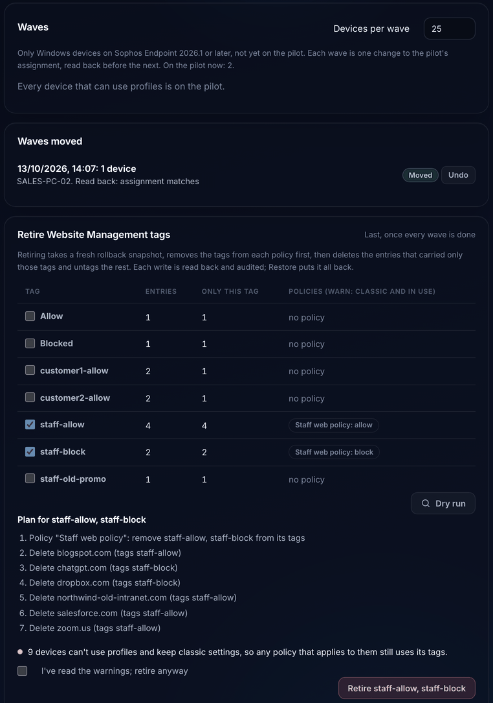

# Web Profiles Assistant

A local web tool that takes a Sophos Fusion (formerly Sophos Central) tenant, or a partner's whole estate, from classic Sophos Endpoint Web Control policies and Website Management tags to web filtering profiles and site lists.

> **Unofficial tool, not from Sophos and not supported by Sophos.** It calls the public Sophos Fusion APIs with a credential you supply. Confirm every setting in Sophos Fusion before you change it, and try it on a test tenant first. Every step has been tested with writes on test tenants. The read-only steps have also been tested on real customer tenants and a real partner estate (see [Testing](#testing)).

## What it looks like

Readiness scorecard for one tenant: fixes before the pilot, things to plan around, eligible devices.



Clean-up sorts each Website Management entry into Covered, Exception or Remove, with the reason, using DNS and real SophosLabs categories from Intelix.



The site list cleaner classifying a pasted list, ready to export CSVs for site lists.



Design maps a classic policy to a Custom profile group by group.



Build creates the site lists, the profile and a disabled pilot policy, each read back as matching.



Pilot digest of warned and blocked hits (sample events), with a narrow Allow.



A promotion wave read back, then the dry-run plan to retire Website Management tags.



The screenshots come from a test tenant; its name and device names are replaced.

## What it does

Checks only read; every write is previewed in a dry run, sent once, read back, recorded in the audit log, and can be rolled back.

| Step | What you get |
| --- | --- |
| 1. Readiness | A scorecard per tenant: fix before the pilot, plan around, check by hand, passing. A customer report (HTML or PDF) and a rollback snapshot. With a partner credential, the same for every tenant in the estate |
| 2. Clean up | Every Website Management entry checked against SophosLabs (Intelix) and DNS and sorted into Covered, Exception or Remove, with the reason. Only exceptions move on |
| 3. Design | Each classic policy mapped to the nearest preset or a Custom profile, with the difference group by group, fitted under 20 profiles and 20 site lists |
| 4. Build | A dry run, then site lists, a profile and a pilot policy at the top of the order, assigned to the devices or user groups you pick. Rollback and a check against the snapshot |
| Site list cleaner | The clean-up on its own: paste a list, load a CSV, or read Website Management. Exports CSVs ready for site lists, and can create the lists |
| 5. Pilot | Web Control events collected daily from the SIEM API, a digest of warned and blocked hits by site, reason, user and day, and a narrow Allow for a host in one click |
| 6. Promote and retire | Devices that can use profiles moved onto the pilot in waves, each read back, then Website Management tags retired last, with a restore |

Customers use a tenant credential. Partners use a partner credential, or a tenant credential when they work inside one customer.

## Quick start

You need Node.js 20 or later. For the PDF report you also need Chrome or Edge on the same computer.

```bash
git clone https://github.com/Aaronjacobs000/sophos-web-profiles-assistant.git
cd sophos-web-profiles-assistant
npm ci
npm run build
npm start
```

Open http://127.0.0.1:3110. The setup wizard asks how you connect:

1. One tenant: in Sophos Fusion, go to Global Settings > API Credentials, add a credential, and paste its Client ID and Client Secret. Give the tenant a name to show, because the API doesn't return a tenant's name to a tenant credential.
2. Partner or organization: paste a partner credential (from Sophos Partner Care) or an Enterprise dashboard credential.

The wizard tests the credential with Sophos before it saves it, and takes an optional SophosLabs Intelix credential too. Credentials go into `.env` in the repo folder, which git ignores. Change them later on the Credentials page.

## SophosLabs Intelix (optional)

The clean-up step looks up each site's SophosLabs category with the Intelix URL lookup API. Intelix is a separate subscription on AWS Marketplace, billed per lookup (5,000 free a month, then US$0.002 each, at the time of writing). Add the Client ID, Secret and region (au, us or de) in the setup wizard or on the Credentials page; Test asks Intelix for a token and costs nothing. A credential works in all three regions, so pick the nearest.

Without Intelix the clean-up still runs: it checks DNS, removes dead, repeated and unused entries, and keeps the rest as exceptions until you decide them in the table or in the CSV.

Lookups cost money, so the clean-up only looks up entries a policy acts on, and never ranges, whole top-level domains or private names. A site SophosLabs doesn't know yet comes back with no category and is kept until you decide.

Tested live on 13/10/2026: the token call; lookups in au, us and de; the category mapping, Generative AI included; an unknown site; a single IP address; a refused credential; and the single-file cleaner calling Intelix from a file and from `http://localhost`. Rate limiting (5,000 lookups a minute, per the API's own headers) wasn't reached in testing; the retry on a 429 is unit-tested.

## The API role it needs

Checks send GET requests only; the client they use refuses any other method before it leaves the computer, so a read-only role is enough for steps 1 to 3 and the pilot digest. The build, rollback, one-click site lists, narrow Allow, promotion waves and retiring tags write site lists, profiles, policies and Website Management, so they need a role that can write web profiles (API permission `web-profiles:write`) and endpoint policies and settings. The tool was tested with admin-level credentials. The admin who works in Sophos Fusion afterwards needs a role that includes Manage web profiles.

## What each step reads and writes

| Step | Reads | Writes to the tenant |
| --- | --- | --- |
| Readiness | Devices, Web Control and Threat Protection policies (computer and server), Website Management, the classic categories, SSL/TLS decryption settings, scanning exclusions, device groups, user groups, the users a policy names, web filtering profiles and site lists | Nothing |
| Clean up and the site list cleaner | Website Management and Web Control policies; SophosLabs Intelix lookups and DNS | Nothing, unless you create the site lists |
| Design | Policies, Website Management, profile metadata (presets and categories), existing profiles and site lists | Nothing |
| Build | All of the above, then a fresh rollback snapshot | Site lists, one profile, one pilot policy at priority 1 |
| Rollback | The build record and its snapshot | Deletes the pilot policy, then the profile, then the site lists; puts Website Management back from the snapshot |
| Pilot | SIEM events (`/siem/v1/events`), the pilot policy and profile | A narrow Allow: one site in the pilot allows list; the first one creates that list and links it to the profile |
| Promote | The pilot policy and devices | The pilot's assignment, one wave at a time |
| Retire | Website Management, Web Control policies, a fresh snapshot | Tags taken out of each policy's tag settings, then entries deleted or untagged |

On this computer the tool writes `.env`, `data/snapshots/`, `data/results/`, `data/estate/`, `data/cleanup/`, `data/design/`, `data/builds/`, `data/siem/`, `data/pilot/`, `data/promote/`, `data/retire/` and `data/audit.log`. The data folder, `.env` and the audit log are readable only by the account that runs the tool (on Windows they keep the folder's own permissions).

## What the scorecard checks

| Check | Topic |
| --- | --- |
| Devices that can use profiles: Windows with Sophos Endpoint 2026.1 or later, which means the `coreAgent` version in the endpoints API. macOS and older Windows keep classic settings. Linux isn't counted, because Web Control doesn't apply to it | Requirements |
| HTTPS decryption and Block QUIC in every active Threat Protection policy, computer and server | Requirements |
| Decryption exclusions (categories and websites) | Decryption |
| Website exclusions from threat checks, globally and in Threat Protection policies. Web Control skips these sites | Pilot |
| Log web control events in every active Web Control policy (classic and profile) | Pilot |
| Policy order, plus policies that are disabled, assigned to no one, duplicated, or shadowed by a policy above | Inventory |
| Assignments to empty groups, and to deleted users, groups or devices. Sophos drops a deleted user or group from assignments itself, so a policy whose people have all gone shows up as assigned to no one | Inventory |
| Policies that point at a web filtering profile that doesn't exist | Pilot |
| Schedules, which use the endpoint's local time | Inventory |
| Additional security options and Protect against data loss, which profiles have no settings for | Classic settings |
| Website Management entries and tags: unused tags, untagged entries, duplicates, entries a site list won't accept as written (the API refuses `*.example.com`), tags over 750 entries, and more entries than an account's site lists can hold (20 lists of 750) | Website Management |
| Broad Allow entries: a whole top-level domain, a public suffix, an IP range wider than /24, or a shared hosting platform | Website Management |
| Category overrides in Website Management. Profiles have none, so each becomes a site list entry with the action its policy gives that category. Overrides to Phishing & Fraud (34), Spam URLs (46) or Spyware (48), which have no policy setting and are always blocked, become Block entries | Website Management |
| Profiles in use out of the 20 allowed, site lists out of the 20 an account can have, profiles with no description (owner), and profiles close to 20 site lists | Profiles |
| Manage web profiles role; User or Device policy type | Requirements |

When a section can't be read, its checks are skipped and the scorecard says so as a fix. It never treats an unread section as empty.

## How the clean-up decides

Each entry is compared with the profile its policy will get (from the design step), or, in the site list cleaner, with the preset you pick.

| Verdict | When |
| --- | --- |
| Remove | The entry isn't something a site list can hold, repeats an earlier entry, has a tag no policy uses, or its domain doesn't exist in DNS (NXDOMAIN). Timeouts and internal names don't count against it |
| Covered | SophosLabs puts the site in a category the profile already gives the entry's action, or rates it a security risk that the entry blocks (security risk sites are always filtered) |
| Exception | Anything else: the category gives a different action, the site is uncategorized, or there was no lookup. Exceptions go into site lists |

Entries the tool can't settle carry "Decide": no SophosLabs category, a security risk you allow, a site different policies treat differently, or a Translators or Anonymizers site from the old "Proxies and translators" category. Broad entries carry it too, with the reason first: a whole top-level domain (`.com`, `*.com`), a public suffix (`co.uk`), a shared hosting platform (`*.blogspot.com`) or a range wider than /24. Broad entries and entries with mixed actions stay out of the site lists until you decide them. Your decision overrides the verdict.

A category override (an entry that puts a site in a classic category) applies in every policy, with that policy's action for the category, so the clean-up keeps it rather than calling it unused. Overrides to Phishing & Fraud, Spam URLs or Spyware are always blocked and move to a Block list. An override no policy gives an action (category filtering off, or the Custom category) needs a decision. Exceptions become site lists with one action each and at most 750 sites. `*.example.com` becomes `example.com`, which matches the same sites and is the form the API accepts.

## How the design works

- Disabled policies and policies already on a profile are left out. So is a policy with category filtering off and no exceptions, because its profile would add nothing.
- Each remaining policy's classic categories are read as profile categories (classic "inherit" takes the Base policy's action). The nearest of the five presets is the one with the fewest differences; with none, the profile uses the preset, otherwise it's Custom.
- New categories with no classic source, Generative AI among them, take the nearest preset's action until you choose one per profile.
- Flags: the split of "Proxies and translators" into Anonymizers and Translators, classic categories with no profile equivalent, Website Management entries that already act on AI services, category overrides, and broad entries held back until the clean-up decides them.
- Category overrides go into the site lists with the policy's action for that category. When one site has different actions in the same policy (two tags, or a tag and an override), the stricter is kept and flagged; Sophos hasn't said which wins in classic.
- Policies that would get identical profiles share one. When the account would pass 20 profiles, the two closest are merged and the design says so. Site lists are shared where they're identical and must fit 20 for the account.
- Custom profiles always meet the API's coverage rule: every category once, through its group or listed one by one, plus Uncategorized.

## Build, dry run and rollback

The dry run checks the plan against the tenant as it is now: room under 20 profiles and 20 site lists, names already taken, sites per list, the coverage rule, and that the chosen devices and groups exist. Devices that can't use profiles are flagged. Nothing is written.

The build saves a rollback snapshot, then sends each write once and reads it back: the site lists (sites compared), the profile (categories and site list actions compared), then the pilot policy at priority 1 with the profile, logging on and Recommended file types. A write Sophos answers unclearly is looked up by name before anything else happens. Each write goes to the audit log, and the build record keeps every id.

The pilot is assigned through `appliesTo` to devices and device groups, or to user groups, never both. The pilot is a Web Control policy, which applies to computers: the dry run refuses servers and server groups, and so do promotion waves, because the API accepts them on a computer policy anyway. Device groups are always sent with an empty `endpoints` list, because the API answers 500 to `endpointGroups` on its own. You can build the pilot disabled and turn it on later.

Rollback deletes by recorded id in reverse order: the policy, then the profile, then the site lists, each confirmed with a 404. A delete Sophos answers with a 5xx, or that gets no answer in time or loses the connection, can still have gone through, so it's read back too: it counts as done when the object is gone, and the audit log records what the read-back found. A delete Sophos answers with 404 was already gone, and the audit log records it as done. When a delete fails, or read-only mode refuses it, the Pilot and Promote pages keep the pilot and say the rollback didn't finish: roll back again, or carry on with the pilot. If the pilot policy itself is gone from the tenant, both pages say that instead and point to the Build page. When Sophos answers a read of the pilot policy with anything but a 404, the Pilot and Promote pages say they couldn't read it, without calling it gone, and offer a retry. Website Management goes back from the snapshot: missing entries are re-created and changed ones patched, and entries someone else added are left alone. If the snapshot was changed after it was saved (its SHA-256 doesn't match), nothing is restored from it and the rollback says so. Compare with snapshot then reads the tenant and reports what matches. Objects other tools added or removed in the meantime are listed but don't count against a match.

## Pilot digest

The SIEM API keeps about 24 hours of events, so the digest works from events this computer has collected. Turn on collection on the Pilot page, and the server collects every `SIEM_COLLECT_HOURS` hours (6 by default) while it runs. To collect without the tool open, schedule `npm run collect` at least daily with cron, launchd or Task Scheduler; it collects for every tenant with collection turned on, or for one tenant id you name. A collection resumes from the last cursor when it's under 23 hours old. When more than 24 hours have passed since the last good one, it says events may be missing. Events are kept for 90 days in `data/siem/<tenant>/`, one file a day, without repeats.

Events give the action and reason only as text, for example `'https://example.com/setup.exe' warned due to filetype 'Windows Executable (exe)'`. The digest reads that text into site, action and reason. Text it can't read is counted, not dropped. The file type and category wording have both been seen in real events ("blocked due to category '...'"); the site list wording the parser also reads hasn't been seen yet. You can import a saved SIEM events response (JSON) as well; imported events are marked and the digest says how many it includes.

Allow adds the exact host (never its parent domain) to a site list kept for the pilot's allows. A host that covers far more than one site (a whole top-level domain such as `com`, a public suffix such as `co.uk`, or a shared hosting platform) is refused; add an entry that broad in Sophos Fusion if you mean it. The first one creates that list, named after the profile, and links it to the pilot's profile as Allow with the highest site list priority, so it wins over the profile's block and warn lists. The profile is sent whole, as the API requires, and read back. Each Allow has a dry run, an audit entry and an undo; undoing the last one unlinks the list and deletes it. Allow is off, and says why, until there's a pilot and while the pilot policy is gone from the tenant; the server refuses it then too. Rolling the build back deletes the list too. A file type warning, such as an installer download, isn't a category decision: allowing the host lets every file type from it through.

## Promotion waves

Waves hold the devices that can use profiles (Windows computers on Sophos Endpoint 2026.1 or later; servers for a server pilot) that aren't on the pilot yet, grouped by device group, as many per wave as you choose. Moving a wave adds its devices to the pilot's assignment in one change, in the device shape the API accepts, and reads the policy back until they show. Undo puts the assignment back as it was before that wave, latest wave first. A pilot assigned to user groups can't take devices, because the API refuses a policy with both; promote it by user group in Sophos Fusion. Devices that can't use profiles are listed apart: keep a classic policy, and its tags, for them. You can turn the pilot on or off from this page. If the pilot policy is no longer in the tenant, the page says so: roll the build back from the Build page, or build a new pilot.

## Retiring Website Management tags

Do this last, once every wave is done. Choose the tags, run the dry run, then retire. The tool saves a fresh rollback snapshot, then:

1. takes the tags out of every Web Control policy's tag settings (a policy that names a tag with no entries can't be saved, so this goes first)
2. deletes the entries that carried only those tags
3. untags entries that also carry other tags or a category override

Each write is read back and audited, and the record keeps every entry and setting as it was. The tool warns, and asks you to confirm, while devices still depend on the tags: devices that can't use profiles, and enabled classic policies that use them. Restore runs the other way round: entries first (deleted ones re-created with their tags, category and comment), then the policies' tag settings. Compare with snapshot then checks the tenant against the snapshot taken before the retire.

## Rollback snapshot

Every check and every build saves `data/snapshots/<tenant id>/<tenant>_<YYYYMMDD-HHMMSS>.json`. You can download it from the readiness page. It holds:

- every Web Control and server Web Control policy, whole, including settings, priority, enabled state and assignments
- the web settings of every Threat Protection policy: decryption, Block QUIC, web filtering and scanning, and the policy's own web exclusions
- every Website Management entry with its tags, category override and comment
- the tenant's decryption exclusions and its global web scanning exclusions
- every web filtering profile (full settings) and every site list with its sites
- names for each user, group and device group an assignment refers to

Each file carries a SHA-256 of its objects, so a restore can tell when a file was edited, and a build rollback won't restore Website Management from an edited one. A section that couldn't be read is stored as `null` and listed in `unreadSections`, never as an empty list. Each save is also written to `data/audit.log`.

## Customer report

The readiness page offers the report as HTML or PDF. The HTML is one self-contained page with no scripts and no external files. The PDF is that page printed by Chrome or Edge in headless mode. If the tool can't find either browser, set `CHROME_PATH` in `.env`, or open the HTML and print it to PDF yourself.

## Partner estate

Scans read `ESTATE_CONCURRENCY` tenants at once, 4 by default and 8 at most. Each tenant gets its own scorecard, result file and snapshot. On a test partner estate of 148 tenants a full scan took 2 min 58 s: 1,929 read-only calls, 4 tenants at a time, no rate limiting. On a real estate of about 150 tenants it took 3 min 54 s at 3 at a time. Tenants the credential can't read show as Unreadable.

## The static site list cleaner

`npm run build:cleaner` writes `build/site-list-cleaner.html`: one file, no server and no external files, for the paste-and-classify half of the cleaner. It calls SophosLabs Intelix only, with a credential typed into the page and kept in its memory, and exports the same CSVs. Intelix allows these browser calls, so the page works opened as a file or from any web server (both tested). It has no DNS checks. It isn't hosted anywhere; how it ships is a decision for later.

## Read-only mode and keeping a customer apart

To look at a customer's tenant with no chance of changing it, start the tool with `READ_ONLY=1`. Every request to a Sophos host that isn't a GET is then refused before it leaves the computer, except the two token calls (Sophos ID and SophosLabs Intelix). The Sophos client checks each request, and the process's `fetch` is wrapped as well, so nothing gets past either. The top bar shows Read-only, and any step that would write fails with a clear message. Dry runs, the scorecard, the report, the clean-up, design, the pilot digest and wave planning all still work.

Three more settings help keep a customer's credential and data out of the repo folder:

| Setting | What it does |
| --- | --- |
| `WPA_ENV_FILE` | Reads and saves credentials in this file instead of `.env` in the repo folder |
| `WPA_DATA_DIR` | Keeps snapshots, results, SIEM events, records and the audit log in this folder instead of `data/` |
| `WPA_TENANTS` | Comma-separated tenant ids. A partner credential then sees only these tenants, in every step and in the estate scan |

For example:

```bash
READ_ONLY=1 WPA_ENV_FILE=~/secure/customer.env WPA_DATA_DIR=~/secure/customer-data WPA_TENANTS=<tenant id> PORT=3140 npm start
```

## Using it from other machines

The server listens on 127.0.0.1:3110, so only this computer can reach it. To serve other machines, set `HOST` (for example `0.0.0.0`) and limit clients with `ALLOWED_IPS`. The Host and Origin guard refuses requests that name another host, and refuses changes from other pages. Pages on other sites can't show the tool in a frame or call its API. See `.env.example`.

## Known gaps

- **SophosLabs categories.** The Fusion API returns no SophosLabs category for a site, even though the June 2026 community post promised one. The Category Checker tab shows categories in the Sophos Fusion console, but not through the API. The clean-up uses Intelix instead.
- **Reports.** There's no Web Control reports API. SIEM events go back about 24 hours and give the action and reason as free text, so the pilot digest has to collect daily and parse the text. The digest has run on real Web Control events from a customer tenant, read-only; the tests use synthetic events in `test/fixtures/` that copy the live wording.
- **Turning the pilot on.** The on and off switch is unit-tested only; the live tests kept the pilot off so no device's browsing changed.
- **Admin role.** The API can't show an admin's role, so the Manage web profiles check is manual.
- **Inferred mapping.** "Additional security options" and "Protect against data loss" have no API settings of their own. The tool reads them as classic categories 0, 2, 10 and 54, based on Help wording. Sophos hasn't confirmed this.
- **User or Device.** The API has no policy type field; a policy is a user or device policy by what it's assigned to. Pick the targets before you build.
- **Scoring on real estates.** Real tenants of up to about 2,900 devices and a 150-tenant estate have been read, but their classic configuration was light: the most Website Management entries in any tenant was about 80, and the most Web Control policies five. A tenant with thousands of entries or dozens of policies is still untested.
- **Threat Protection fixes.** The scorecard flags decryption and Block QUIC; the tool doesn't change Threat Protection policies. Turn them on in Sophos Fusion.

## Testing

- **Test tenants, with writes (13/10/2026):** every step end to end, including the build, rollback, narrow Allow, promotion waves and retiring tags with a restore. Each run left the tenant identical to its snapshot.
- **Real customer tenants, read-only (13/10/2026):** every read path, with read-only mode on the whole time and nothing changed: the scorecard, snapshot, HTML and PDF report, clean-up with SophosLabs and DNS, the site list cleaner, design, the build dry run, the pilot digest, wave planning and the retire dry run.
  - A tenant of about 430 devices with Base policies, one Website Management entry and a day of real Web Control events.
  - A larger tenant of about 2,900 devices with three Web Control policies (one custom, with tags), 26 Website Management entries, all of them category overrides, and a day of real events. The scorecard took 13 s, the device list 11 s, the clean-up with SophosLabs 6 s, and planning waves for about 1,700 eligible devices 10 s.
- **A real partner estate, read-only (13/10/2026):** about 150 tenants and 13,000 devices. The estate scan took 3 min 54 s at 3 tenants at a time: about 2,050 calls and no rate limiting. 4 tenants refused the credential and showed as Unreadable.
- **SophosLabs Intelix, live (13/10/2026):** see [SophosLabs Intelix](#sophoslabs-intelix-optional).

## Development

```bash
npm run typecheck     # TypeScript, no output files
npm test              # build, then node --test
npm run dev           # rebuild and restart on change
npm run build:cleaner # the static site list cleaner
npm run collect       # collect SIEM web events for the pilot digest
```

The logic lives in `backend/src/domain/` (eligibility, sites, scorecard, snapshot, report, categories, csv, intelix, cleanup, design, restore, digest, promote). These are pure modules with no Node or browser imports; the static site list cleaner inlines them. The API wrappers are in `backend/src/sophos/api/`, and the services that write are in `backend/src/services/`. The server plumbing (credentials, network guard, audit log, retries, write read-back) comes from the Sophos Fusion Tenant Migration Tool; see `ATTRIBUTIONS.md`.

## Security

To report a vulnerability, see [SECURITY.md](SECURITY.md).

## License

MIT License, © 2026 Aaron Jacobs. See `LICENSE`.
